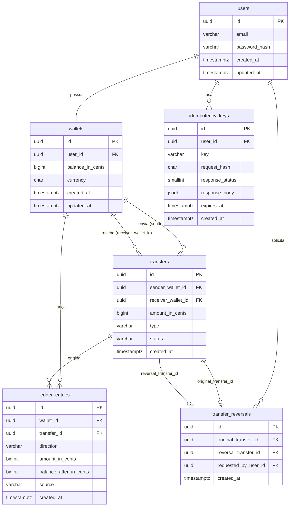
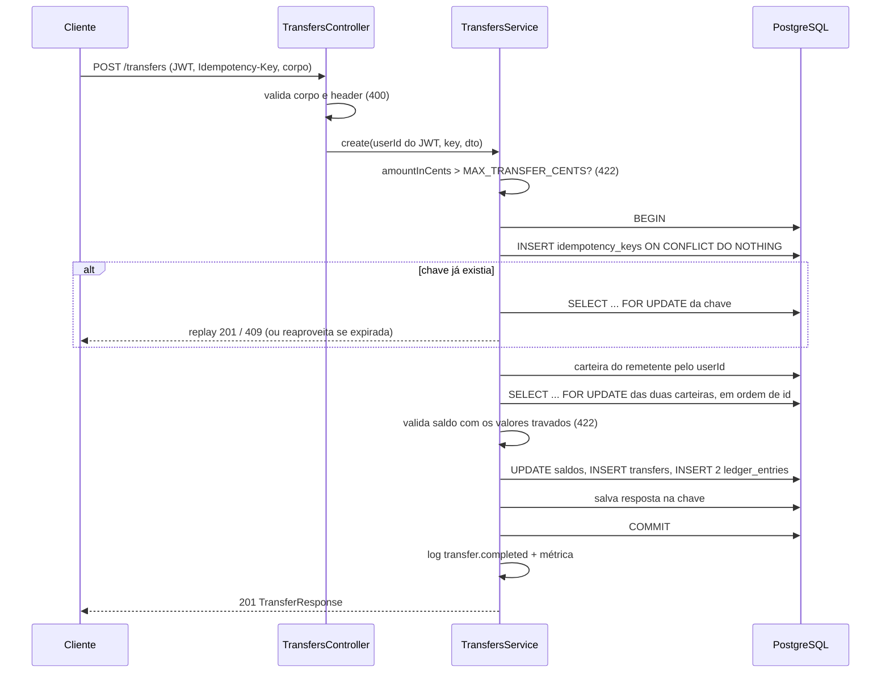

# Carteira Financeira API

API REST de carteira digital: usuários se cadastram, autenticam com JWT e transferem saldo entre carteiras.
Cada transferência é atômica, idempotente por chave e registrada em um ledger append-only; o remetente pode estornar dentro de uma janela de tempo.
O extrato é paginado por cursor, e a aplicação expõe health checks, métricas Prometheus e logs estruturados.

**Stack:** Node.js 24, NestJS 11, TypeScript, PostgreSQL 16, TypeORM, Jest, Supertest, Testcontainers, Docker Compose.

---

## 1. Início rápido

### Pré-requisitos

- Docker Desktop (ou Docker Engine) com **Compose v2** (`docker compose`, não `docker-compose`).
- Node.js 24.9 ou superior (`engines` do `package.json`). Só é necessário para os scripts `npm run docker:*` e para os testes; `docker compose up --build` sozinho não usa o Node do host.

### Passos

```bash
git clone <url-do-repositório> wallet
cd wallet
```

Copie o `.env.example` para `.env`:

```bat
:: Windows (CMD)
copy .env.example .env
```

```bash
# Linux / macOS / Git Bash
cp .env.example .env
```

Suba tudo:

```bash
docker compose up --build
```

Atalho: `npm run docker:up` cria o `.env` a partir do `.env.example` se ele não existir (um `.env` existente nunca é alterado), verifica se as portas estão livres e roda `docker compose up --build -d --wait`, que só retorna quando a API está saudável. Não precisa de `npm install`: os scripts usam só módulos nativos do Node.

### O que sobe, em ordem (`compose.yaml`)

1. **`db`**: PostgreSQL 16 com volume `pgdata`, publicado em `127.0.0.1:${DATABASE_HOST_PORT:-5433}`. Healthcheck com `pg_isready`.
2. **`migrate`**: espera o `db` ficar saudável, aplica as migrations (`npm run migration:run:prod`) e termina.
3. **`seed`**: espera o `migrate` terminar com sucesso. Cria os usuários de demonstração se `SEED_DEMO=true` e `NODE_ENV` diferente de `production`; caso contrário imprime "Seed ignorado" e sai com 0. É idempotente: se os usuários já existem, só mostra os dados, sem alterar saldos.
4. **`api`**: espera o `seed` terminar com sucesso e sobe na porta `${API_PORT:-3000}`. Healthcheck em `/health/live`.

As três imagens saem do mesmo `Dockerfile` (multi-stage, `node:24-alpine`, usuário `node`).

### URLs

| O quê | URL |
| --- | --- |
| Swagger (UI) | http://localhost:3000/docs |
| API | http://localhost:3000/api/v1 |
| Liveness | http://localhost:3000/health/live |
| Readiness | http://localhost:3000/health/ready |
| Métricas (Prometheus) | http://localhost:3000/metrics |

`/health/*` e `/metrics` ficam fora do prefixo `/api/v1`.

### Usuários de demonstração

| E-mail | Saldo inicial | Senha |
| --- | --- | --- |
| `alice@example.com` | 100000 centavos (R$ 1.000,00) | `SEED_USER_PASSWORD` do `.env` (`Demo@12345` no `.env.example`) |
| `bob@example.com` | 50000 centavos (R$ 500,00) | idem |

Os `walletId` aparecem no fim da saída do seed:

```bash
npm run docker:seed-info     # equivale a: docker compose logs seed
```

Também é possível fazer login como o usuário e chamar `GET /api/v1/wallets/me`.

### Portas ocupadas e recomeço

- Se a 3000 ou a 5433 estiverem em uso (por exemplo, por um `npm run start:dev` ou outro Postgres), mude `API_PORT` ou `DATABASE_HOST_PORT` no `.env`. O `npm run docker:up` detecta o conflito antes de subir e diz qual variável alterar; o `docker compose up` direto apenas falha ao publicar a porta. Se mudar `API_PORT`, troque a porta nas URLs acima.
- Para apagar o banco (volume) e subir do zero: `npm run docker:reset`.

| Comando | O que faz |
| --- | --- |
| `npm run docker:up` | Cria `.env` se faltar, checa portas e sobe tudo em segundo plano |
| `npm run docker:reset` | `docker compose down -v` e sobe de novo (apaga os dados) |
| `npm run docker:logs` | Acompanha os logs da API |
| `npm run docker:seed-info` | Mostra de novo a saída do seed |
| `npm run docker:down` | Para e remove os containers (mantém o volume) |

---

## 2. Como testar

```bash
npm ci
npm test            # unitários (Jest, sem banco)
npm run test:int    # integração (exige Docker em execução)
```

Os dois scripts rodam o Jest com `node --experimental-vm-modules`, necessário porque algumas dependências (ex.: `@nestjs/config`) são publicadas como ESM.

`npm run test:int` sobe um PostgreSQL próprio por suíte com **Testcontainers**, aplica as migrations nele e roda as suítes em série. Ele **nunca usa o banco do compose**: o `TestContext` aponta as variáveis `DATABASE_*` para o container antes de carregar o `AppModule`, e `assertUsesContainer` aborta antes de qualquer `TRUNCATE` se a conexão não for a do container. Pode rodar com o compose de pé.

### O que cada suíte cobre

| Suíte | Cobre |
| --- | --- |
| `src/common/filters/all-exceptions.filter.spec.ts` | Erros transitórios do Postgres (`40P01`, `40001`, `55P03`) viram `503 SERVICE_BUSY` com `Retry-After`; violação de CHECK vira 500 sem expor o nome da constraint |
| `src/modules/transfers/transfers.service.spec.ts` | Limite de valor antes de abrir transação, saldo validado com o valor lido depois do lock, ordem dos locks, autotransferência sem lock, estorno decidido pelo status lido com lock |
| `test/integration/auth.int.spec.ts` | Cadastro sem vazar hash, e-mail duplicado (inclusive com maiúsculas), rollback de usuário quando a carteira falha, 401 idêntico para senha errada e e-mail inexistente, `/wallets/me` |
| `test/integration/transfers.int.spec.ts` | Fluxo feliz, saldo insuficiente sem efeito colateral, autotransferência, destino inexistente, replay e conflito de idempotência, header ausente, validação de entrada, acesso só de participantes |
| `test/integration/transfers-concurrency.int.spec.ts` | Duas transferências simultâneas que juntas excedem o saldo (uma passa), 20 transferências cruzadas A→B/B→A sem deadlock, mesma chave em paralelo, 10 débitos paralelos |
| `test/integration/reversals.int.spec.ts` | Estorno restaura saldos, original imutável, dois estornos simultâneos (201 e 409), já estornada, destinatário (403), terceiro (404), estorno de estorno, destinatário sem saldo, janela expirada |
| `test/integration/consistency.int.spec.ts` | Rollback total quando o ledger falha no meio da transferência e do estorno, saldo de cada carteira igual à soma do ledger, trigger bloqueando `UPDATE`/`DELETE` no ledger |
| `test/integration/metrics.int.spec.ts` | `/metrics` sem ids nem e-mails, rotas agrupadas pelo padrão, token exigido quando configurado, contadores de transferência e de erro de domínio |

### Roteiro pelo Swagger (http://localhost:3000/docs)

1. **Login:** `POST /api/v1/auth/login` com `{"email":"alice@example.com","password":"Demo@12345"}`. Copie o `accessToken`, clique em **Authorize** e cole só o token (sem `Bearer`).
2. **Saldo:** `GET /api/v1/wallets/me` devolve `balanceInCents: 100000`. Pegue o `walletId` do Bob com `npm run docker:seed-info`.
3. **Transferência e replay:** `POST /api/v1/transfers` com header `Idempotency-Key: teste-1` e corpo `{"receiverWalletId":"<walletId do Bob>","amountInCents":1050}` → 201. Execute de novo, igual: 201 com o mesmo `id`, sem novo débito. Com a mesma chave e `amountInCents: 2000` → `409 IDEMPOTENCY_KEY_CONFLICT`.
4. **Saldo insuficiente:** nova chave (`teste-2`) e `amountInCents: 200000` → `422 INSUFFICIENT_BALANCE`; o saldo não muda.
5. **Estorno:** `POST /api/v1/transfers/{id}/reversal` com o `id` do passo 3 → 201 com `type: REVERSAL`. `GET /api/v1/transfers/{id}` mostra a original com `status: REVERSED`. Repetir o estorno → `409 TRANSFER_ALREADY_REVERSED`.
6. **Extrato:** `GET /api/v1/wallets/me/transactions?limit=2` lista os lançamentos do mais recente para o mais antigo; envie o `nextCursor` em `cursor` para a próxima página.

Login e cadastro aceitam 5 requisições por minuto por IP, transferência 20 e estorno 10; acima disso a resposta é 429.

---

## 3. Escopo

**Dentro:** cadastro, login JWT, uma carteira por usuário, consulta de saldo, extrato paginado, transferência entre carteiras com idempotência, estorno total pelo remetente, ledger de auditoria, logs estruturados, health checks e métricas.

**Fora, de propósito:** depósito e saque reais (o saldo inicial vem do seed), estorno parcial, múltiplas carteiras ou moedas, refresh token e logout, papéis de usuário, agendamento, notificações, frontend e stack de monitoramento (Prometheus/Grafana).

---

## 4. Decisões de arquitetura

| Decisão | Motivo |
| --- | --- |
| PostgreSQL | Transações ACID, lock de linha (`FOR UPDATE`), CHECK, UNIQUE e triggers para garantir regras no próprio banco. |
| TypeORM | Integração oficial com o Nest e acesso ao `EntityManager` da transação, inclusive `setLock('pessimistic_write')` e SQL cru quando necessário. |
| Centavos em `bigint` | Inteiro é exato; float não representa 0,1. Na aplicação os valores são `number` e qualquer valor acima de `Number.MAX_SAFE_INTEGER` gera erro em vez de perder precisão. |
| UUID gerado pela aplicação | O id existe antes do insert (útil para montar transfer e ledger na mesma transação) e não expõe volume de registros. |
| Lock pessimista nas duas carteiras, em ordem de id | Serializa operações concorrentes sobre a mesma carteira; a ordem fixa evita deadlock entre A→B e B→A. |
| Saldo armazenado + ledger | `wallets.balance_in_cents` dá leitura direta do saldo; o ledger registra cada débito e crédito com o saldo resultante, para auditoria e conciliação. |
| Argon2id | Algoritmo de hash de senha resistente a ataque por GPU (memory-hard). |
| Paginação por cursor `(created_at, id)` | Custo estável em históricos longos e sem duplicar ou pular itens quando entram lançamentos novos. O cursor guarda o timestamp com microssegundos. |
| Camadas Controller → Service → Repository → Entity | Controller só trata HTTP, service concentra a regra e repository isola o ORM; o service é testado com mocks. |
| Repositories próprios | Encapsulam o TypeORM e sempre pegam o `EntityManager` corrente, então participam da transação sem receber o manager por parâmetro. |
| `TransactionManager` com AsyncLocalStorage | O service abre a transação com `tx.run(...)` sem conhecer o ORM; chamadas aninhadas reaproveitam a transação aberta. |
| Exception filter global | Exceções de domínio têm `code` e viram HTTP em um único lugar, com um formato de erro único. |
| Seed e flag `SEED_DEMO` | A API não tem endpoint de depósito; o seed dá saldo para demonstração. A flag impede rodá-lo por acidente, e com `NODE_ENV=production` a validação só aceita `false`. |

---

## 5. Modelagem de dados



### Constraints, índices e trigger (das migrations)

| Tabela | Nome | Definição | Para quê |
| --- | --- | --- | --- |
| users | `uq_users_email` | UNIQUE INDEX em `lower(email)` | E-mail único sem diferenciar maiúsculas |
| wallets | (inline) | `user_id` UNIQUE, FK `users` | Uma carteira por usuário |
| wallets | `ck_wallets_balance_non_negative` | `balance_in_cents >= 0` | Segunda barreira contra saldo negativo |
| transfers | `ck_transfers_amount_positive` | `amount_in_cents > 0` | Valor sempre positivo |
| transfers | `ck_transfers_type` | `type IN ('TRANSFER','REVERSAL')` | Domínio do tipo |
| transfers | `ck_transfers_status` | `status IN ('COMPLETED','REVERSED')` | Domínio do status |
| transfers | `ck_transfers_different_wallets` | `sender_wallet_id <> receiver_wallet_id` | Impede autotransferência no banco |
| transfers | `ix_transfers_sender` | `(sender_wallet_id, created_at DESC, id DESC)` | Consultas por remetente |
| transfers | `ix_transfers_receiver` | `(receiver_wallet_id, created_at DESC, id DESC)` | Consultas por destinatário |
| transfer_reversals | (inline) | `original_transfer_id` UNIQUE, FK `transfers` | Uma transferência só pode ser estornada uma vez |
| transfer_reversals | (inline) | `reversal_transfer_id` UNIQUE, FK `transfers` | Cada estorno corresponde a um único vínculo |
| transfer_reversals | `ck_reversals_different_transfers` | `original_transfer_id <> reversal_transfer_id` | Vínculo coerente |
| ledger_entries | `ck_ledger_direction` | `direction IN ('DEBIT','CREDIT')` | Domínio da direção |
| ledger_entries | `ck_ledger_amount_positive` | `amount_in_cents > 0` | Valor positivo; o sentido vem de `direction` |
| ledger_entries | `ck_ledger_balance_after_non_negative` | `balance_after_in_cents >= 0` | Saldo resultante nunca negativo |
| ledger_entries | `ck_ledger_source` | `source IN ('TRANSFER','REVERSAL','DEMO_SEED')` | Domínio da origem |
| ledger_entries | `ck_ledger_transfer_matches_source` | `(source = 'DEMO_SEED') = (transfer_id IS NULL)` | Só o crédito do seed não tem transferência |
| ledger_entries | `ix_ledger_wallet` | `(wallet_id, created_at DESC, id DESC)` | Extrato paginado por cursor |
| ledger_entries | `ix_ledger_transfer` | `(transfer_id)` | Lançamentos de uma transferência |
| ledger_entries | `trg_ledger_entries_append_only` | `BEFORE UPDATE OR DELETE ... FOR EACH ROW` chama `forbid_ledger_mutation()`, que lança exceção | Ledger append-only. Trigger em vez de `REVOKE` porque o usuário da aplicação é dono da tabela e poderia se reconceder o privilégio |
| idempotency_keys | `uq_idempotency_user_key` | UNIQUE `(user_id, key)` | Chave de idempotência por usuário |
| idempotency_keys | `ix_idempotency_expires_at` | `(expires_at)` | Índice por expiração |

---

## 6. Fluxos

### Transferência (`POST /api/v1/transfers`)



1. `JwtAuthGuard` exige token válido; o remetente é sempre o `userId` do token.
2. O `ValidationPipe` valida o corpo: `receiverWalletId` UUID (convertido para minúsculas) e `amountInCents` inteiro positivo. Campos extras dão 400.
3. O header `Idempotency-Key` é obrigatório e deve casar com `^[A-Za-z0-9._-]{1,128}$` (400).
4. Valor acima de `MAX_TRANSFER_CENTS` dá `422 AMOUNT_EXCEEDS_LIMIT`, antes de abrir transação.
5. Abre a transação e tenta inserir a chave (`user_id`, `key`, hash SHA-256 de `receiverWalletId` + `amountInCents`, `expires_at = agora + IDEMPOTENCY_TTL_HOURS`). Se ela já existe, trava a linha e decide (ver Idempotência).
6. Busca a carteira do usuário (`404 WALLET_NOT_FOUND`); se for a mesma do destino, `422 SELF_TRANSFER`.
7. Trava as duas carteiras com `FOR UPDATE`, sempre em ordem crescente de id. Destino inexistente dá `404 WALLET_NOT_FOUND`.
8. Com os valores já travados: saldo menor que o valor dá `422 INSUFFICIENT_BALANCE`; saldo resultante acima de `Number.MAX_SAFE_INTEGER` dá `422 BALANCE_LIMIT_EXCEEDED`.
9. Atualiza os dois saldos, insere a transferência (`TRANSFER`, `COMPLETED`) e dois lançamentos no ledger (`DEBIT` no remetente, `CREDIT` no destinatário, cada um com o saldo resultante).
10. Salva status 201 e o corpo da resposta na chave de idempotência e faz commit. Qualquer erro antes disso desfaz tudo, inclusive a chave.
11. Depois do commit: log `transfer.completed` e métrica `wallet_transfers_total{type="TRANSFER",result="completed"}`.

### Idempotência

- A chave é por usuário: duas pessoas podem usar o mesmo valor sem conflito.
- **Replay:** mesma chave e mesmo corpo devolvem 201 com o **corpo salvo da primeira execução**, sem novo débito. O status atual (por exemplo, `REVERSED` depois de um estorno) deve ser consultado em `GET /transfers/{id}`.
- **Payload diferente** com a mesma chave: `409 IDEMPOTENCY_KEY_CONFLICT`.
- **Falha não consome a chave:** a chave é gravada na mesma transação da transferência; um 422, 404 ou erro inesperado faz rollback e a mesma chave pode ser reutilizada.
- **Requisições paralelas** com a mesma chave: a segunda espera a primeira terminar (conflito de UNIQUE e `FOR UPDATE` na linha) e então recebe o replay.
- **TTL:** depois de `IDEMPOTENCY_TTL_HOURS` (padrão 24), a chave expirada é reaproveitada: o hash e a expiração são regravados e a requisição é processada como nova.

### Estorno (`POST /api/v1/transfers/:id/reversal`)

Tudo em uma transação:

1. Lê a transferência e a carteira do usuário. Usuário sem carteira: `404 WALLET_NOT_FOUND`. Transferência inexistente ou em que o usuário não participa: `404 TRANSFER_NOT_FOUND`.
2. Se o usuário é o destinatário: `403 REVERSAL_NOT_ALLOWED`. Só o remetente estorna.
3. Trava as duas carteiras em ordem de id e depois a própria transferência (`FOR UPDATE`). As regras abaixo usam os valores travados.
4. `type` diferente de `TRANSFER` (estorno de estorno): `422 TRANSFER_NOT_REVERSIBLE`.
5. `status = REVERSED`: `409 TRANSFER_ALREADY_REVERSED`. Dois estornos simultâneos resultam em um 201 e um 409; o `UNIQUE` em `transfer_reversals.original_transfer_id` é a segunda barreira.
6. Mais de `REVERSAL_WINDOW_HOURS` (padrão 72) desde a criação: `422 REVERSAL_WINDOW_EXPIRED`.
7. Destinatário original com saldo menor que o valor: `422 REVERSAL_FUNDS_UNAVAILABLE`. Não há estorno parcial nem saldo negativo.
8. Saldo do remetente acima de `Number.MAX_SAFE_INTEGER`: `422 BALANCE_LIMIT_EXCEEDED`.
9. Debita o destinatário original, credita o remetente, cria uma transferência nova `REVERSAL` (`COMPLETED`, partes invertidas), grava o vínculo em `transfer_reversals`, muda só o `status` da original para `REVERSED` e insere dois lançamentos `REVERSAL` no ledger. Valor e partes da original não mudam.
10. Depois do commit: log `transfer.reversed` e métrica. A resposta (201) é o registro do estorno.

O estorno não usa `Idempotency-Key`: repetir a chamada dá 409.

---

## 7. API

Rotas de negócio com prefixo `/api/v1`. Autenticação por `Authorization: Bearer <accessToken>`. Qualquer rota pode responder 500 (erro inesperado) e, nas que usam o banco, 503 `SERVICE_BUSY` (conflito transitório).

| Método | Rota | Descrição | Auth | Status |
| --- | --- | --- | --- | --- |
| POST | `/api/v1/auth/register` | Cria usuário e carteira (saldo 0, BRL) na mesma transação | Não | 201, 400, 409, 429 |
| POST | `/api/v1/auth/login` | Devolve `accessToken`, `tokenType` e `expiresIn` | Não | 200, 400, 401, 429 |
| GET | `/api/v1/wallets/me` | Carteira e saldo do usuário | JWT | 200, 401, 404 |
| GET | `/api/v1/wallets/me/transactions` | Extrato do ledger; `limit` (1 a 100, padrão 20) e `cursor` | JWT | 200, 400, 401, 404 |
| POST | `/api/v1/transfers` | Transfere; header `Idempotency-Key` obrigatório | JWT | 201, 400, 401, 404, 409, 422, 429, 503 |
| GET | `/api/v1/transfers/:id` | Estado atual da transferência ou estorno; só participantes | JWT | 200, 400, 401, 404 |
| POST | `/api/v1/transfers/:id/reversal` | Estorna (só o remetente) | JWT | 201, 400, 401, 403, 404, 409, 422, 429, 503 |
| GET | `/health/live` | Processo de pé; não consulta dependências | Não | 200 |
| GET | `/health/ready` | Ping no banco | Não | 200, 503 |
| GET | `/metrics` | Métricas Prometheus | Bearer `METRICS_TOKEN`, se definido | 200, 401 |
| GET | `/docs` | Swagger UI | Não | 200 |

As rotas de negócio também respondem 429 acima do limite global (`THROTTLE_LIMIT` por `THROTTLE_TTL_MS`).

### Códigos de erro de domínio

| `error` | HTTP | Quando |
| --- | --- | --- |
| `INVALID_CURSOR` | 400 | Cursor do extrato corrompido ou adulterado |
| `INVALID_CREDENTIALS` | 401 | E-mail ou senha incorretos (resposta única) |
| `REVERSAL_NOT_ALLOWED` | 403 | Destinatário tentou estornar |
| `WALLET_NOT_FOUND` | 404 | Carteira do usuário ou de destino não existe |
| `TRANSFER_NOT_FOUND` | 404 | Transferência inexistente ou usuário não participa |
| `EMAIL_ALREADY_REGISTERED` | 409 | E-mail já cadastrado |
| `TRANSFER_ALREADY_REVERSED` | 409 | Transferência já estornada |
| `IDEMPOTENCY_KEY_CONFLICT` | 409 | Chave reutilizada com outro corpo |
| `SELF_TRANSFER` | 422 | Destino é a própria carteira |
| `AMOUNT_EXCEEDS_LIMIT` | 422 | Valor acima de `MAX_TRANSFER_CENTS` |
| `INSUFFICIENT_BALANCE` | 422 | Saldo do remetente insuficiente |
| `BALANCE_LIMIT_EXCEEDED` | 422 | Saldo resultante passaria de 2^53 − 1 centavos |
| `REVERSAL_FUNDS_UNAVAILABLE` | 422 | Destinatário sem saldo para devolver |
| `TRANSFER_NOT_REVERSIBLE` | 422 | Tentativa de estornar um estorno |
| `REVERSAL_WINDOW_EXPIRED` | 422 | Fora da janela `REVERSAL_WINDOW_HOURS` |

Fora do domínio: erros HTTP do Nest usam o nome do status (`BAD_REQUEST`, `UNAUTHORIZED`, `NOT_FOUND`, `TOO_MANY_REQUESTS`); deadlock, falha de serialização e lock indisponível do Postgres viram `503 SERVICE_BUSY` com `Retry-After: 1`; o resto vira `500 INTERNAL_SERVER_ERROR` com mensagem genérica.

### Formato de erro

Todo erro tem o mesmo corpo. `details` aparece só em erros de validação; `requestId` é o mesmo do header `X-Request-Id`.

```json
{
  "statusCode": 422,
  "error": "INSUFFICIENT_BALANCE",
  "message": "Saldo insuficiente",
  "requestId": "0cef4fd1-cbbd-4f5b-9ef4-6bdeda802b72",
  "timestamp": "2026-11-04T00:04:23.717Z",
  "path": "/api/v1/transfers"
}
```

```json
{
  "statusCode": 400,
  "error": "BAD_REQUEST",
  "message": "Dados inválidos",
  "details": ["property extra should not exist", "email must be an email"],
  "requestId": "7bdf9c03-4b8e-43b3-bf0d-880e73625875",
  "timestamp": "2026-11-04T00:04:23.990Z",
  "path": "/api/v1/auth/register"
}
```

---

## 8. Segurança

- Senhas com Argon2id. Hash nunca sai em resposta (coluna com `select: false` e DTOs de saída) nem em log.
- Senha no cadastro: 8 a 128 caracteres, com maiúscula, minúscula, número e caractere especial. No login, até 128 caracteres.
- JWT HS256 (algoritmo fixado na assinatura e na verificação), expiração por `JWT_EXPIRES_IN` (padrão `15m`), segredo com no mínimo 32 caracteres.
- O remetente de transferências e estornos vem do token, nunca do corpo.
- Acesso por posse: o usuário só vê a própria carteira e as transferências em que participa; para os demais a resposta é 404, sem revelar que o recurso existe.
- `ValidationPipe` global com `whitelist` e `forbidNonWhitelisted`: campo não declarado no DTO dá 400.
- `helmet` em todas as rotas; em `/docs` a Content-Security-Policy é desligada para a UI do Swagger funcionar.
- Rate limit por IP: 5 requisições por minuto em cadastro e login, 20 em transferência e 10 em estorno; demais rotas, `THROTTLE_LIMIT` por `THROTTLE_TTL_MS` (padrão 100 a cada 60 s); `/health` e `/metrics` sem limite.
- Login responde o mesmo `401 INVALID_CREDENTIALS` para e-mail inexistente e senha errada, e verifica um hash falso quando o e-mail não existe, para o tempo de resposta não revelar o cadastro.
- Logs com `redact` de `authorization`, `cookie`, `set-cookie`, `password`, `passwordHash` e `accessToken`; o serializer de requisição só registra id, método e URL.
- Banco como última barreira: CHECKs de saldo e valores, UNIQUE do estorno e trigger append-only no ledger.
- `/metrics` exige `Authorization: Bearer <METRICS_TOKEN>` quando a variável está definida (comparação em tempo constante).
- Imagem final roda como usuário não-root (`node`) e só com dependências de produção.
- Variáveis validadas na inicialização (Joi): a aplicação não sobe com configuração inválida, e com `NODE_ENV=production` só aceita `SEED_DEMO=false` e `THROTTLE_DISABLED=false`. O guard de rate limit também ignora `THROTTLE_DISABLED` em produção.

---

## 9. Observabilidade

**Logs** (`nestjs-pino`, JSON em uma linha; `LOG_PRETTY=true` só para desenvolvimento local):

- Cada requisição tem um `requestId`: o valor do header `X-Request-Id` se casar com `^[A-Za-z0-9._-]{1,64}$`, senão um UUID novo. Ele volta no header `X-Request-Id`, no corpo de erro e em todos os logs da requisição.
- Nível do log de requisição pelo status: 5xx `error`, 4xx `warn`, demais `info`. O nível mínimo vem de `LOG_LEVEL`; com `NODE_ENV=test` os logs ficam desligados. `/health` e `/metrics` não geram log de requisição.
- Eventos de negócio: `auth.registered`, `auth.login_succeeded`, `transfer.completed`, `transfer.replayed`, `transfer.reversed` (só ids, sem saldos). Erros de domínio são logados como `warn` com o código; erros inesperados como `error` com stack.
- Nunca são logados: headers de autenticação, cookies, senhas, hashes e tokens.

**Health:** `/health/live` só indica que o processo responde (banco fora do ar não deve reiniciar o container); `/health/ready` faz ping no banco e responde 503 se ele estiver inacessível.

**Métricas** (`/metrics`, formato Prometheus, prefixo `wallet_`):

- `wallet_http_request_duration_seconds` (histograma; labels `method`, `route`, `status_code`).
- `wallet_transfers_total` (labels `type` = `TRANSFER`/`REVERSAL`, `result` = `completed`/`replayed`).
- `wallet_domain_errors_total` (label `code`).
- Métricas padrão do processo Node (`collectDefaultMetrics`: CPU, memória, event loop, GC).

O label `route` é o padrão da rota (`/api/v1/transfers/:id/reversal`), nunca a URL real: ids no label criariam uma série por transferência. Rotas inexistentes ficam como `unmatched`.

Logs de negócio e métricas de transferência são registrados **depois do commit**, fora da transação; não participam do caminho que grava dinheiro e não podem desfazê-lo.

---

## 10. Variáveis de ambiente

Validadas em `src/config/env.validation.ts`. "Obrigatória" significa sem padrão; o `.env.example` traz valores de desenvolvimento.

| Variável | Padrão | Descrição |
| --- | --- | --- |
| `NODE_ENV` | `development` | `development`, `test` ou `production` |
| `PORT` | `3000` | Porta da API dentro do container/processo |
| `DATABASE_HOST` | obrigatória | Host do Postgres (`.env.example`: `localhost`; o compose força `db`) |
| `DATABASE_PORT` | `5432` | Porta do Postgres (`.env.example`: `5433`, para rodar a API fora do Docker; o compose força `5432`) |
| `DATABASE_USER` | obrigatória | Usuário do banco |
| `DATABASE_PASSWORD` | obrigatória | Senha do banco |
| `DATABASE_NAME` | obrigatória | Nome do banco |
| `JWT_SECRET` | obrigatória | Segredo do JWT, mínimo 32 caracteres |
| `JWT_EXPIRES_IN` | `15m` | Validade do token |
| `MAX_TRANSFER_CENTS` | `5000000` | Valor máximo por transferência (R$ 50.000,00) |
| `REVERSAL_WINDOW_HOURS` | `72` | Janela de estorno |
| `IDEMPOTENCY_TTL_HOURS` | `24` | Validade da chave de idempotência |
| `LOG_LEVEL` | `info` | `debug`, `info`, `warn` ou `error` |
| `LOG_PRETTY` | `false` | Logs legíveis via `pino-pretty` (devDependency; o compose força `false`) |
| `THROTTLE_TTL_MS` | `60000` | Janela do rate limit global |
| `THROTTLE_LIMIT` | `100` | Requisições por janela no rate limit global |
| `THROTTLE_DISABLED` | `false` | Desliga o rate limit (usado nos testes); só `false` em produção |
| `SEED_DEMO` | `false` | Habilita o seed (`.env.example`: `true`); só `false` em produção |
| `SEED_USER_PASSWORD` | opcional | Senha dos usuários de demo (o seed usa `Demo@12345` se ausente) |
| `METRICS_TOKEN` | opcional | Mínimo 16 caracteres; se definido, `/metrics` exige `Bearer <token>` |
| `API_PORT` | `3000` | Só compose: porta publicada da API no host |
| `DATABASE_HOST_PORT` | `5433` | Só compose: porta publicada do Postgres no host (`127.0.0.1`) |

---

## 11. Estrutura do projeto

```
src/
  main.ts                    # bootstrap, logger e Swagger em /docs
  configure-app.ts           # helmet, X-Request-Id, prefixo /api/v1, ValidationPipe (reusado nos testes)
  app.module.ts              # módulos, config, TypeORM, throttler, filter global
  config/                    # validação das variáveis de ambiente (Joi)
  common/database/           # TransactionManager e transformer de bigint
  common/dto/                # formato de erro para o Swagger
  common/errors/             # DomainError e exceções de domínio
  common/filters/            # AllExceptionsFilter (erro → HTTP)
  common/guards/             # JwtAuthGuard e guard de rate limit
  common/logging/            # configuração do nestjs-pino
  database/migrations/       # schema, constraints e trigger do ledger
  database/seeds/            # seed de demonstração
  modules/auth/              # cadastro, login, estratégia JWT
  modules/users/             # entity e repository de usuários
  modules/wallets/           # carteira, extrato e cursor
  modules/ledger/            # entity e repository do ledger
  modules/transfers/         # transferência, estorno e idempotência
  modules/health/            # liveness e readiness
  modules/metrics/           # /metrics e middleware de latência HTTP
test/integration/            # testes de integração e helpers/test-context.ts
scripts/                     # ensure-env.mjs e preflight.mjs (npm run docker:up/reset)
compose.yaml                 # db, migrate, seed, api
Dockerfile                   # build multi-stage, runtime não-root
```

---

## 12. Limitações conhecidas

- O rate limit fica em memória e é por IP. Com várias instâncias cada uma conta separado, e como `trust proxy` não está configurado, atrás de um proxy todos os clientes aparecem com o IP do proxy.
- `created_at` usa `now()`, que é o início da transação, não o commit. Uma transação que começou antes e terminou depois pode gravar um lançamento com timestamp anterior ao último já paginado, e o cliente que segue o cursor não o vê.
- O seed usa duas transações (cadastro e crédito). Se a segunda falhar, o usuário fica com saldo 0 e rodar o seed de novo não corrige, porque ele não altera usuários existentes.
- Valores acima de 2^53 − 1 centavos (cerca de R$ 90 trilhões) não são suportados: a aplicação recusa em vez de perder precisão.
- O trigger do ledger é por linha (`FOR EACH ROW`), então bloqueia `UPDATE` e `DELETE` mas não `TRUNCATE`.
- Chaves de idempotência expiradas não são apagadas; só são reaproveitadas quando a mesma chave volta.
- Sem `METRICS_TOKEN`, `/metrics` é público.

## 13. Melhorias futuras

Refresh token com rotação e logout, depósito via webhook de provedor (ex.: PIX), outbox para eventos de domínio, Sentry e OpenTelemetry, Prometheus + Grafana com alertas, limites por usuário e 2FA.

---

## 14. Uso de IA

Usei IA em tarefas mecânicas: configuração, DTOs, scripts, documentação e testes derivados de regras já definidas. A modelagem, as regras de transferência e estorno e os testes de concorrência foram escritos e revisados por mim.
